

  

<h1 align="center">Rakesh Kumar</h1>

  

  10+ years building Java backend systems — Spring Boot microservices, event-driven services, secure REST APIs, and deep learning pipelines. 
  Focused on service discovery, JWT authorization, cloud-native delivery, and reproducible ML systems.

<strong>I build the behind-the-scenes software that helps apps handle requests securely, move information between services, and keep working as they grow.</strong>

  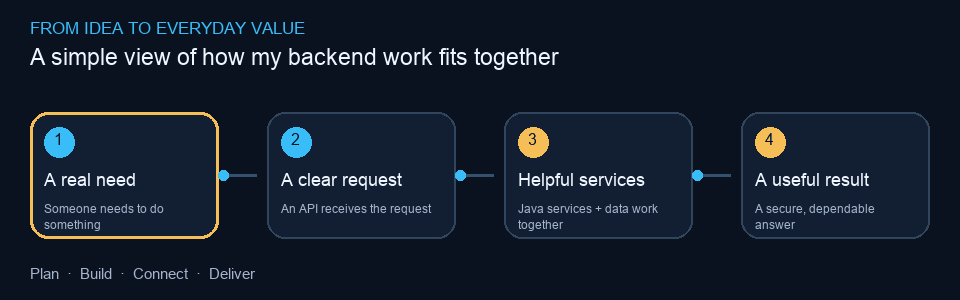

  
  
  
  

---

## Engineering Focus

| Area | What I work on |
| --- | --- |
| **Microservices** | Split a large application into smaller services that can find and talk to one another. |
| **Application security** | Check who is making a request, what they are allowed to do, and whether their sign-in is still valid. |
| **Event-driven systems** | Pass updates through message queues so different parts of an app can react independently. |
| **Java / JVM** | Build the server-side logic and tune how it handles many tasks at once. |
| **API design** | Create clear, documented ways for apps to request information and receive useful responses. |
| **Cloud-native delivery** | Package, automate, and deploy applications so they are easier to run and update. |
| **Deep learning & ML systems** | Design, train, and evaluate convolutional neural networks with reproducible pipelines and automated hyperparameter sweeps. |

---

## Technology Stack

**Languages**  
`Java 11 / 17 / 21` · `Python 3.10+` · `TypeScript` · `C`

**Backend**  
`Spring Boot` · `Spring Security` · `Spring WebFlux` · `Spring Data JPA` · `Hibernate`

**Deep learning & data science**  
`TensorFlow / Keras` · `Convolutional Neural Networks (VGG6)` · `Weights & Biases (W&B)` · `NumPy` · `Matplotlib` · `Google Colab (CUDA / T4 GPU)`

**Architecture & messaging**  
`Microservices` · `Netflix Eureka` · `REST` · `Apache Kafka` · `RabbitMQ` · `SOAP / WSDL`

**Data**  
`MySQL` · `Apache Cassandra` · `H2`

**Cloud, containers & delivery**  
`Docker` · `Microsoft Azure` · `GitHub Actions` · `Jenkins` · `Maven`

**Security**  
`JWT (HS256)` · `BCrypt` · `method-level authorization`

**Testing & API docs**  
`JUnit 5` · `Mockito` · `MockMvc` · `springdoc-openapi`

  

---

## Featured Projects

Click a card to open the repository or live product.

<table>
  <tr>
    <td width="50%" valign="top">
      
       
      <strong>Spring Boot 3 JWT Security</strong> 
      JWT-based stateless API authentication with refresh tokens, logout revocation, and role-based authorization. 
      <code>Java 21</code> <code>Spring Security</code> <code>JWT</code> <code>MySQL</code> 
      <a href="https://github.com/Rakesh4ever/spring-boot-3-jwt-security">View repository →</a> · <a href="#jwt-security-flow">Execution flow ↓</a>
    </td>
    <td width="50%" valign="top">
      
       
      <strong>Microservices Intercommunication</strong> 
      Three Spring Boot services: a Eureka registry, a provider, and a consumer that resolves <code>hello-server</code> by name. 
      <code>Spring Cloud</code> <code>Eureka</code> <code>REST</code> <code>Ribbon</code> 
      <a href="https://github.com/Rakesh4ever/micro-services">View repository →</a> · <a href="#microservices-flow">Execution flow ↓</a>
    </td>
  </tr>
  <tr>
    <td width="50%" valign="top">
      <a href="https://github.com/Rakesh4ever/KafkaProducer">
        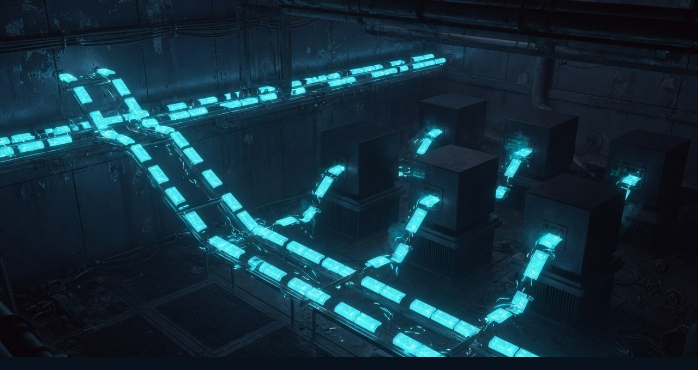
      </a>
       
      <strong>Kafka Producer</strong> 
      REST endpoint that publishes messages onto an Apache Kafka topic after ZooKeeper and the broker are up. 
      <code>Spring Kafka</code> <code>REST</code> <code>Apache Kafka</code> 
      <a href="https://github.com/Rakesh4ever/KafkaProducer">View repository →</a>
    </td>
    <td width="50%" valign="top">
      
       
      <strong>Java Virtual Threads</strong> 
      Compares launch cost of 100,000 virtual threads vs platform threads using <code>Thread.ofVirtual()</code>. 
      <code>Java</code> <code>Project Loom</code> <code>Concurrency</code> 
      <a href="https://github.com/Rakesh4ever/JavaVirtualThreads">View repository →</a>
    </td>
  </tr>
  <tr>
    <td width="50%" valign="top">
      
       
      <strong>Reactive Cassandra POC</strong> 
      Spring WebFlux + WebClient service that persists entities to Apache Cassandra. 
      <code>WebFlux</code> <code>WebClient</code> <code>Cassandra</code> 
      <a href="https://github.com/Rakesh4ever/POC">View repository →</a>
    </td>
    <td width="50%" valign="top">
      <a href="https://github.com/Rakesh4ever/iitm-cs6886w-vgg6-cifar10">
        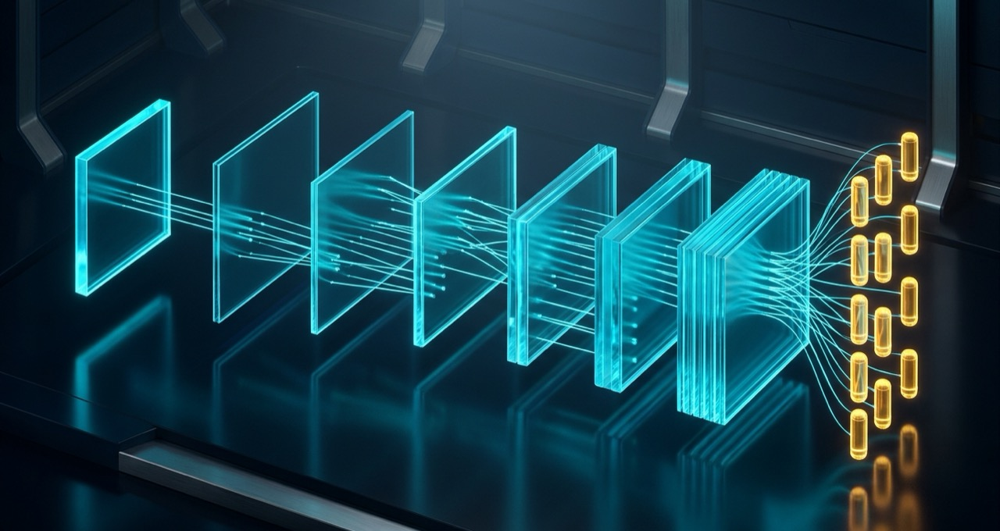
      </a>
       
      <strong>VGG6 CNN on CIFAR-10 (IITM CS6886W)</strong> 
      Modular 6-layer CNN in TensorFlow/Keras with channel-wise Z-score standardization, data augmentation, and W&amp;B sweeps across 6 activations and 6 optimizers (<strong>88.94% val / 88.45% test accuracy</strong>). 
      <code>Python</code> <code>TensorFlow / Keras</code> <code>VGG6 CNN</code> <code>W&amp;B</code> <code>CIFAR-10</code> 
      <a href="https://github.com/Rakesh4ever/iitm-cs6886w-vgg6-cifar10">View repository →</a> · <a href="#vgg6-analytical-report">Analytical report ↓</a> · <a href="https://github.com/Rakesh4ever/iitm-cs6886w-vgg6-cifar10/blob/main/cs25m530_Rakesh_Kumar.pdf">Report PDF →</a>
    </td>
  </tr>
  <tr>
    <td width="50%" valign="top">
      
       
      <strong>FinanceControl.net</strong> 
      Personal-finance platform for budget, SIP, tax, and FX tools. 
      <a href="https://financecontrol.net">Visit site →</a>
    </td>
    <td width="50%" valign="top">
      
       
      <strong>Tithi.Live</strong> 
      City-aware Hindu panchang — tithi, nakshatra, rahu kaal, and muhurta. 
      <a href="https://tithi.live">Visit site →</a>
    </td>
  </tr>
</table>

---

## Architecture

Three public repos with the clearest request and training paths. Components match the code and READMEs — nothing invented.

### JWT security request path & animated execution flow

  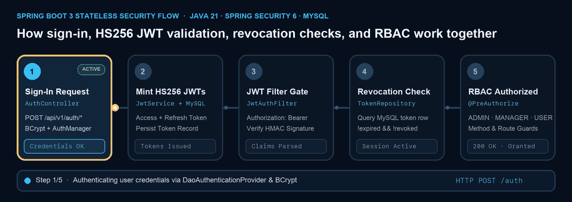

  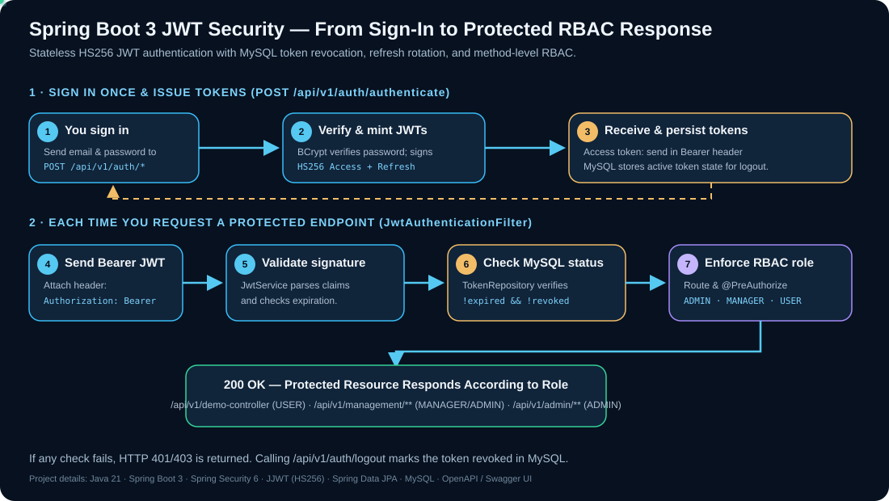

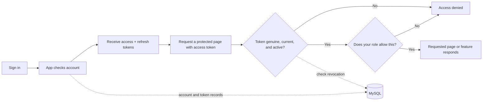

<strong>🔐 Expand Spring Boot 3 JWT Security Filter Chain &amp; RBAC Route Matrix</strong>

 

| Stage / Endpoint | Component | Responsibility & Security Enforcement |
| :--- | :--- | :--- |
| `POST /api/v1/auth/register` · `/authenticate` | `AuthenticationController` · `AuthenticationService` | Hashes passwords with `BCryptPasswordEncoder`, authenticates via `DaoAuthenticationProvider`, revokes prior active tokens, and persists new `HS256` token row in MySQL. |
| `Authorization: Bearer <jwt>` | `JwtAuthenticationFilter` (`OncePerRequestFilter`) | Extracts Bearer token, validates HMAC-SHA256 signature and expiration via `JwtService`, and queries `TokenRepository` (`!expired && !revoked`) before populating `SecurityContextHolder`. |
| `POST /api/v1/auth/refresh-token` | `AuthenticationService#refreshToken` | Validates refresh token signature and issues a fresh access token without requiring user re-login. |
| `POST /api/v1/auth/logout` | `LogoutService` (`LogoutHandler`) | Marks the stored MySQL token record `expired = true` and `revoked = true`, immediately invalidating subsequent replay attempts. |
| `/api/v1/management/**` · `/api/v1/admin/**` | `SecurityConfiguration` + `@PreAuthorize` | Enforces fine-grained role (`ADMIN`, `MANAGER`, `USER`) and authority (`admin:read`, `admin:create`, `management:read`, etc.) guards at both URL and method levels. |

### Service discovery call path & animated execution flow

  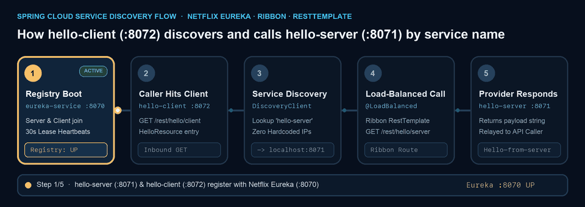

  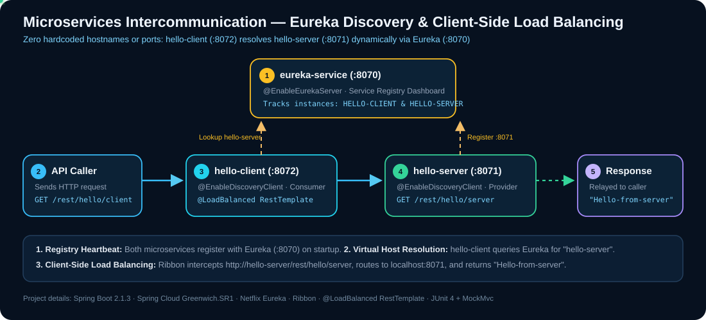

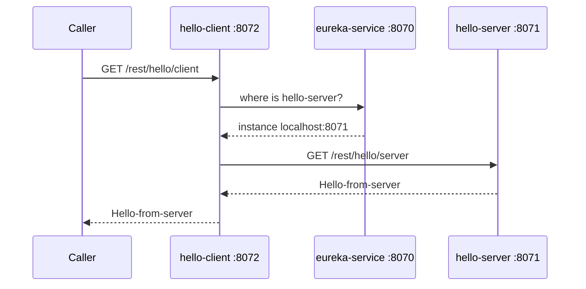

<strong>🌐 Expand Microservices Topology, Ports &amp; Spring Cloud Discovery Mechanics</strong>

 

| Service Module | Port | Spring Cloud Annotations | Runtime Role in Call Path |
| :--- | :---: | :--- | :--- |
| **`eureka-service`** | `:8070` | `@SpringBootApplication` · `@EnableEurekaServer` | Standalone Netflix Eureka registry (`registerWithEureka: false`, `fetchRegistry: false`); maintains live instance leases for registered services. |
| **`hello-server`** | `:8071` | `@SpringBootApplication` · `@EnableDiscoveryClient` | Registers under logical application name `hello-server` with Eureka (`:8070/eureka`) and exposes `GET /rest/hello/server` returning `"Hello-from-server"`. |
| **`hello-client`** | `:8072` | `@SpringBootApplication` · `@EnableDiscoveryClient` · `@LoadBalanced` | Exposes `GET /rest/hello/client`; injects a `@LoadBalanced RestTemplate` that resolves `http://hello-server/rest/hello/server` via Eureka + Ribbon without hardcoded IPs. |

### VGG6 CNN architecture & animated execution flow

  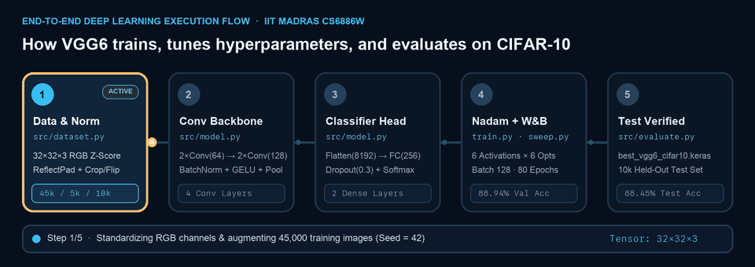

  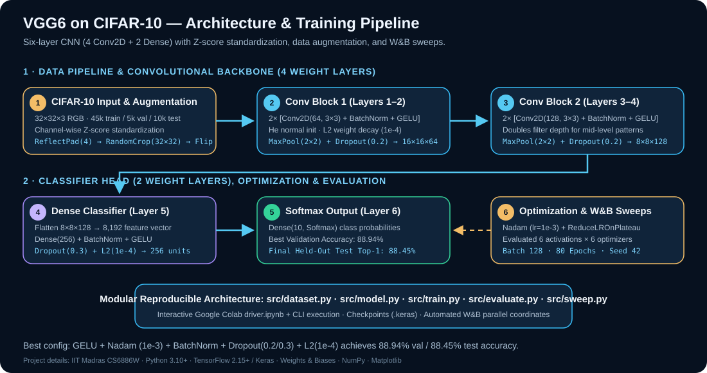

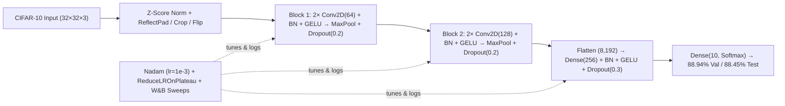

---

## Deep Learning Analytical Report — VGG6 on CIFAR-10 (IITM CS6886W)

Empirical systems & hyperparameter study from [`iitm-cs6886w-vgg6-cifar10`](https://github.com/Rakesh4ever/iitm-cs6886w-vgg6-cifar10) ([Full Report PDF](https://github.com/Rakesh4ever/iitm-cs6886w-vgg6-cifar10/blob/main/cs25m530_Rakesh_Kumar.pdf)). Built as an importable Python package (`src/dataset.py`, `src/model.py`, `src/train.py`, `src/evaluate.py`, `src/sweep.py`) with deterministic seeding (`seed = 42`) on an NVIDIA Tesla T4 GPU.

  

### Executive Summary & Best Verified Configuration

| Metric / Parameter | Verified Value | Engineering Rationale |
| :--- | :--- | :--- |
| **Best Validation Accuracy** | **88.94%** | Achieved on 5,000 held-out validation images (`Epoch 80`, `seed = 42`) |
| **Held-Out Test Top-1 Accuracy** | **88.45%** (`loss = 0.358`) | Standalone evaluation via `python -m src.evaluate` on 10,000 unseen test images |
| **Architecture (6 Weight Layers)** | `4 Conv2D + 2 Dense` | Block 1 (`2×64`), Block 2 (`2×128`), Classifier (`8192 → 256 → 10 Softmax`) |
| **Optimal Activation** | `GELU` (**+20.54%** over `Sigmoid`) | Smooth probabilistic gating (`x · Φ(x)`) prevents dead neurons & vanishing gradients |
| **Optimal Optimizer** | `Nadam` (`lr = 1e-3`) | Combines Adam's 2nd-moment scaling with Nesterov look-ahead momentum (**+7.04%** over `SGD`) |
| **Batch Size & LR Schedule** | `128` (`352` steps/epoch) | Balances GPU throughput and stochastic gradient noise with `ReduceLROnPlateau (0.5×)` |
| **Regularization Pipeline** | `BatchNorm` + `Dropout(0.2/0.3)` + `L2(1e-4)` | Coupled with `ReflectPad(4) → RandomCrop(32×32) → HorizontalFlip` to curb overfitting |

<strong>📊 Expand Full Comparative Ablation Tables (Activations · Optimizers · Systems Scaling)</strong>

 

#### 1. Activation Function Ablation (`BatchNorm = True`)

| Activation | Val Accuracy | Convergence Behavior & Mathematical Explanation |
| :--- | :---: | :--- |
| **GELU** ★ | **88.94%** | Smooth, non-monotonic gating (`x · Φ(x)`) permits small negative gradients for slightly negative inputs, preventing dead filters and smoothing the loss landscape. |
| **SiLU (Swish)** | **88.40%** | Smooth self-gated activation (`x · σ(x)`) with a bounded negative trough; closely matches GELU in convergence speed and generalization. |
| **Leaky ReLU** | **87.90%** | Retains a `0.1` slope for negative inputs, mitigating dying ReLU while preserving piecewise-linear speed. |
| **ReLU** | **87.62%** | Non-saturating positive gradient (`f'(x) = 1` for `x > 0`), but hard zeroing for `x < 0` causes a subset of filters to suffer from dying neurons. |
| **Tanh** | **81.20%** | Zero-centered output in `(-1, 1)` aids layer conditioning, but saturates at both tails (`f'(x) = 1 - tanh²(x) → 0`), slowing deeper gradient flow. |
| **Sigmoid** | **68.40%** | Non-zero-centered `(0, 1)` output induces zig-zag weight updates and its maximum derivative is `0.25`, causing severe vanishing gradients across 6 layers (`<25%` without BatchNorm). |

#### 2. Optimizer Dynamics Ablation (`80 Epochs`)

| Optimizer | Best LR | Val Accuracy | Optimization & Convergence Dynamics |
| :--- | :---: | :---: | :--- |
| **Nadam** ★ | `1e-3` | **88.94%** | Combines Adam's per-parameter second-moment scaling with **Nesterov look-ahead momentum**, yielding the fastest early convergence and highest final accuracy. |
| **Adam** | `1e-3` | **88.35%** | Bias-corrected exponential moving averages of first (`m_t`) and second (`v_t`) gradient moments provide rapid, stable convergence. |
| **Nesterov-SGD** | `1e-2` (`μ=0.9`) | **88.10%** | Evaluates gradients at the projected look-ahead position (`θ + μ·v_t`), damping oscillations in high-curvature ravines. |
| **RMSprop** | `1e-3` | **86.75%** | Normalizes updates by an exponentially decaying average of squared gradients, controlling oscillations without premature stalling. |
| **Standard SGD** | `1e-2` (`μ=0.0`) | **81.90%** | Updates strictly along noisy instantaneous mini-batch gradients; progresses slowly along flat directions and oscillates across steep canyon walls. |
| **Adagrad** | `1e-2` | **74.80%** | Accumulates squared gradients monotonically in the denominator (`G_t = G_{t-1} + g_t²`), shrinking the effective learning rate toward zero prematurely. |

#### 3. Systems Throughput vs. Generalization (`Batch Size`, `Learning Rate`, `Epochs`)
- **Batch Size (`32, 64, 128, 256, 512`)**: Small batches (`32, 64` → `~88.3%`) inject beneficial stochastic gradient noise (`1,406` and `703` steps/epoch) at the cost of lower GPU utilization; **Batch Size `128` (`352` steps/epoch → `88.94%`)** achieves the optimal trade-off between NVIDIA T4 throughput and flat-minima generalization; large batches (`256, 512` → `~85.6%`) perform only `88` steps/epoch at `bs=512` and converge toward sharper minima.
- **Learning Rate (`1e-4` to `1e-2`)**: `1e-3` (with `ReduceLROnPlateau` halving LR on 5-epoch plateaus down to `1e-6`) enables fast initial descent in the first 20 epochs (`~85.4%`) followed by fine-grained convergence (`88.94%` at 80 epochs).

---

## GitHub Activity

  <picture>
    <source media="(prefers-color-scheme: dark)" srcset="https://github-readme-stats-anuraghazra1.vercel.app/api?username=Rakesh4ever&show_icons=true&theme=tokyonight&hide_border=true">
    <source media="(prefers-color-scheme: light)" srcset="https://github-readme-stats-anuraghazra1.vercel.app/api?username=Rakesh4ever&show_icons=true&theme=default&hide_border=true">
    
  </picture>
  <picture>
    <source media="(prefers-color-scheme: dark)" srcset="https://github-readme-stats-anuraghazra1.vercel.app/api/top-langs/?username=Rakesh4ever&layout=compact&theme=tokyonight&hide_border=true">
    <source media="(prefers-color-scheme: light)" srcset="https://github-readme-stats-anuraghazra1.vercel.app/api/top-langs/?username=Rakesh4ever&layout=compact&theme=default&hide_border=true">
    
  </picture>

---

## Currently Exploring

- Deep learning systems engineering, CNN architectures, and hyperparameter optimization (IIT Madras CS6886W)
- Modern Java and JVM execution models (virtual threads, Spring Boot 4)
- Distributed-system design around service discovery and messaging
- Cloud-native backend delivery
- AI-assisted software engineering

---

## Certifications & Continuous Learning

Public LinkedIn credentials. Skill assessments are LinkedIn Skill Assessments, not vendor professional exams.

| Certification | Issuer | Year |
| --- | --- | --- |
| [Java](https://www.linkedin.com/in/rakesh-kumar/detail/assessments/Java/report/) | LinkedIn | 2019 |
| [Spring Framework](https://www.linkedin.com/in/rakesh-kumar/detail/assessments/Spring%20Framework/report/) | LinkedIn | 2020 |
| [MySQL](https://www.linkedin.com/in/rakesh-kumar/detail/assessments/MySQL/report/) | LinkedIn | 2020 |
| [Simplifying data pipelines with Apache Kafka](https://courses.cognitiveclass.ai/certificates/4a715cc938e049c38a12034a74a572b7) | IBM Cognitive Class | 2018 |
| [Hadoop Programming](https://www.linkedin.com/in/rakesh-kumar/details/certifications/) | IBM | 2018 |
| [Angular](https://www.linkedin.com/in/rakesh-kumar/detail/assessments/Angular/report/) | LinkedIn | 2021 |

---

## Let's Connect

I'm interested in backend engineering, distributed systems, Java platform work, and cloud-native architecture.

  <a href="https://www.linkedin.com/in/rakesh-kumar">LinkedIn</a>
  ·
  <a href="https://github.com/Rakesh4ever">GitHub</a>
  ·
  <a href="https://financecontrol.net">FinanceControl.net</a>
  ·
  <a href="https://tithi.live">Tithi.Live</a>

